# OTA Updater — Design

A broadcast OTA (over-the-air) firmware update system in Rust.

- **Sender**: binary diff → compression → slicing → Reed-Solomon FEC → signed manifest → UDP multicast broadcast (data carousel).
- **Receiver**: listen for shards → FEC reconstruct → per-group authentication → *streaming* patch application into a new image → Ed25519-signed hash verification → atomic install.

Design decisions (agreed up front):

| Topic | Decision |
|---|---|
| Diff / FEC | Hand-written: bsdiff-style diff with Larsson–Sadakane suffix sort, streaming patcher, GF(2^8) Reed-Solomon |
| Crypto | Audited crates only: `ed25519-dalek` 3 (Ed25519, `verify_strict`), `sha2` 0.11 (SHA-256) |
| FEC scheme | Block (systematic) Reed-Solomon erasure code: *k* data + *m* parity shards per group |
| Transport | Real UDP multicast on the loopback interface (`239.255.77.1`), per-receiver simulated impairments |
| Compression | `zstd` streaming compression of the patch stream |

## 1. Data flow

```mermaid
flowchart LR
  subgraph Sender
    A[old.img + new.img] --> B["bsdiff diff (qsufsort)"]
    B --> C[zstd stream]
    C --> D["slice: groups of k shards"]
    D --> E["RS encode: +m parity per group"]
    A --> M["manifest: hashes, FEC params, per-group SHA-256"]
    M --> S["Ed25519 sign"]
    E --> F["interleave + carousel rounds + rate limit"]
    S --> F
  end
  F -->|"UDP multicast 239.255.77.1"| G
  subgraph Receiver
    G["impairment sim: loss / burst / dup / reorder / corrupt"] --> H["CRC32 check, bad packet = erasure"]
    H --> I["verify manifest signature (pinned key)"]
    H --> J["per group: any k of k+m shards, RS reconstruct"]
    I --> J
    J --> K["group SHA-256 == signed manifest"]
    K --> L["in-order group release"]
    L --> N["zstd decoder"]
    N --> O["streaming patch apply: old.img -> slot_b.tmp"]
    O --> P["new image SHA-256 == signed value, atomic rename"]
  end
```



**Security property**: every byte fed into the patcher is already authenticated — the manifest
signature is verified first, and the manifest carries a signed SHA-256 for every FEC group. The output
image is additionally checked against the signed full-image hash before it is activated.

## 2. Crate layout

Cargo package `ota_updater` (library + two binaries); workspace member `viz/wasm` holds the
browser simulation (see `docs/VISUALIZATION.md`). Feature `native` (default) adds sockets, OS
randomness, the C zstd library and the CLIs; without it the library is pure Rust and builds for
`wasm32-unknown-unknown` (zstd via `ruzstd`).

```
src/lib.rs
src/gf256.rs      GF(2^8), poly 0x11D, exp/log tables, slice multiply-accumulate
src/rs.rs         Systematic Reed-Solomon erasure codec, [I; Cauchy] matrix, Gauss-Jordan inverse
src/suffix.rs     Larsson–Sadakane qsufsort (as used by bsdiff), i32 indices, explicit stack
src/diff.rs       bsdiff 4.x match/extend scoring -> interleaved streamable patch (+ zstd, optionally multi-frame)
src/patch.rs      Push-based StreamingPatcher (+ pull `apply`), PushDecompressor; O(64 KiB) memory
src/hashio.rs     Hashing reader/writer adapters (SHA-256 on the fly)
src/varint.rs     LEB128 varints + zigzag (patch record headers)
src/slicer.rs     Patch <-> groups/shards layout, padding shards, group hashes
src/manifest.rs   Manifest binary format, domain-separated Ed25519 sign / verify_strict
src/keys.rs       Key generation, hex key files (native)
src/wire.rs       Packet encode/decode with CRC32 trailer
src/channel.rs    Impairment simulator: Bernoulli / Gilbert-Elliott loss, dup, reorder, corrupt
src/net.rs        socket2 multicast setup, SO_REUSEPORT, SO_RCVBUF, token-bucket rate limiter (native)
src/sender.rs     Prepare (diff+compress+slice+FEC+sign) and broadcast schedule
src/receiver/core.rs  Sans-IO receiver state machine (ReceiverCore -> RxEvent), also used by viz/wasm
src/receiver/mod.rs   Driver: source -> impairment -> ReceiverCore -> apply thread -> verified install
src/imagegen.rs   Synthetic firmware image pair generator (demo / tests)
src/bin/ota-sender.rs     keygen | gen-images | diff | send
src/bin/ota-receiver.rs   listen | apply
tests/e2e_inprocess.rs    deterministic sender -> impairment -> receiver, no sockets
tests/e2e_udp.rs          loopback multicast, two receivers with different loss
```

## 3. Algorithms

### 3.1 Differencing (差分) — bsdiff

1. Build the suffix array of `old` with Larsson–Sadakane `qsufsort` (prefix doubling with ternary-split
   quicksort; O(n log n)). The recursion of `split` is replaced by an explicit job stack, preserving the
   original left → assign → right order (required for correctness of in-place group renumbering).
2. Scan `new`: at each position binary-search the suffix array for the longest exact match, then use
   bsdiff's *approximate-match* scoring (accept a match if it beats the current alignment by > 8 bytes),
   extend forwards/backwards allowing mismatches, and resolve overlaps. Unlike bsdiff 4.3, the search
   treats a suffix that is a proper prefix of the query as smaller (bsdiff's truncated `memcmp` calls
   it equal and can miss the longest match); on the synthetic test images this changed no patch byte.
3. Each step yields a control triple `(diff_len, extra_len, seek)`:
   - `diff_len` bytes encoded as `new[i] - old[j]` (wrapping) — mostly zeros for shifted code, very compressible;
   - `extra_len` literal bytes copied from `new`;
   - `seek` adjusts the old-file cursor.

**Streamable patch format.** Classic BSDIFF40 stores control / diff / extra in three separate sections
(the applier needs three cursors → random access). We interleave instead, so the patch can be applied
from a single forward-only stream:

```
header : "OTAPATCH" (8) | version u16 = 1 | old_size u64 | new_size u64        (little endian)
record*: diff_len varint | extra_len varint | seek zigzag-varint | diff bytes | extra bytes
```

Records continue until `new_size` bytes have been produced; trailing data is an error. The entire stream
(header + records) is zstd-compressed (default level 19).

### 3.2 Streaming restore (流式差分还原)

`patch::apply(old: Read+Seek, old_len, patch: Read, out: Write)`:

- reads the patch sequentially in 64 KiB chunks; for diff bytes `out = old[cur] + diff` (wrapping add),
  extra bytes are copied verbatim, then the old cursor moves by `seek`;
- all lengths/offsets are validated (old reads must stay within `old_len`, output may not exceed
  `new_size`, varints may not overflow) — a malformed patch yields an error, never a panic;
- output goes through a `HashingWriter`, so the SHA-256 of the new image is computed while writing.

On the receiver, the patch reader is a `ChannelReader` fed by FEC-decoded groups, wrapped by the zstd
decoder: the new image is produced *while packets are still arriving*.

### 3.3 Slicing (切片)

| Parameter | Default | Note |
|---|---|---|
| shard size | 1024 B | packet = 28 B header/trailer + 1024 B → well below a 1200 B MTU budget |
| k (data shards / group) | 32 | 32 KiB of patch per group |
| m (parity shards / group) | 8 | 25 % overhead, any 8 lost shards per group per round are recoverable |

Group *g* covers patch bytes `[g·k·S, min((g+1)·k·S, L))`. The last shard of a group is zero-padded.
Data shards lying completely beyond the end of the patch (only possible in the last group) are
*implicit zero shards*: never transmitted, pre-filled by the receiver, but still part of the RS codeword.

### 3.4 Reed-Solomon (纠错编码)

- Field GF(2^8) with primitive polynomial x⁸+x⁴+x³+x²+1 (`0x11D`), generator 2; exp/log tables.
- Systematic generator matrix `[I_k ; C]` where `C` is an m×k Cauchy matrix
  `C[i][j] = 1 / (x_i ⊕ y_j)`, `x_i = k+i`, `y_j = j`. Every square sub-matrix of a Cauchy matrix is
  non-singular, hence every k×k sub-matrix of `[I; C]` is invertible: **any k of the k+m shards recover
  the group** (MDS). Constraint: `k + m ≤ 256`.
- Decode: select k available shards, build the corresponding k×k matrix, invert it with Gauss-Jordan
  elimination in GF(2^8), and recompute only the missing data shards.
- Corrupted packets are detected by CRC32 and treated as erasures (RS erasure decoding requires knowing
  which shards are missing).

### 3.5 Signed manifest (Ed25519签名)

All integers little endian.

```
"OTAMANIF" (8) | format_version u16 = 1
session_id u64 | fw_version u64
old_size u64 | old_sha256 [32]
new_size u64 | new_sha256 [32]
patch_size u64 | patch_sha256 [32] | compression u8 (0 = none, 1 = zstd)
shard_size u16 | k u16 | m u16 | group_count u32
group_sha256 [32] × group_count
```

Signed container: `manifest_len u32 | manifest_bytes | signature [64]`, where the signature is Ed25519
over `"OTA-UPDATER-MANIFEST-v1\0" ‖ manifest_bytes`. The receiver verifies (`verify_strict`, pinned
public key) **before** parsing the manifest body. The container is fragmented into ≤ 1024 B manifest
fragments and re-broadcast periodically.

Receiver acceptance checks: valid signature → `old_sha256`/`old_size` match the local base image →
`fw_version` > installed version (anti-rollback) → sizes/params within limits and self-consistent.

### 3.6 Packet format

```
offset 0  magic "OTA1" (4) | version u8 = 1 | kind u8 | reserved u16 | session_id u64
kind 1 ManifestFrag: frag_index u16 | frag_count u16 | total_len u32 | data_len u16 | data
kind 2 Shard       : group u32 | shard_index u16 | data_len u16 | data (= shard_size bytes)
trailer            : crc32 u32 over all preceding bytes
```

### 3.7 Sender broadcast (UDP模拟广播)

- **Carousel**: the full codeword set is repeated for `--rounds` rounds (or `--forever`) so late joiners
  and unlucky receivers can complete. The manifest fragments are sent at the start of each round and
  every 256 data packets.
- **Interleaving**: `--interleave W` (default 8) sends shard *i* of groups *g … g+W−1* before shard
  *i+1*, spreading a burst of losses over W groups. W = 1 favours streaming latency, large W favours
  burst resilience.
- **Rate limiting**: token bucket (`--rate-kbps`) so the kernel does not drop packets on top of the
  simulated loss.
- Multicast: TTL 1, `IP_MULTICAST_LOOP` on, outgoing interface `127.0.0.1` (macOS `lo0` supports multicast).

### 3.8 Receiver (监听分片 → 纠错 → 流式还原 → 签名校验)

1. Join the multicast group (`SO_REUSEADDR` + `SO_REUSEPORT` so several receivers share the port,
   large `SO_RCVBUF`).
2. Apply the per-receiver impairment simulator, then CRC-check and decode packets.
3. Reassemble manifest fragments → verify signature → acceptance checks. A bad signature only discards
   the reassembly (anti-DoS); a validly signed but inapplicable manifest (wrong base, rollback) rejects
   that session.
4. Shards arriving before the manifest are buffered (bounded) and replayed after acceptance.
5. Per group, once k distinct shards are present: RS reconstruct → truncate → SHA-256 vs signed group
   hash. Mismatch → drop the group's shards and wait for the next round.
6. Completed groups are released **in order** to the apply thread (`ChannelReader` → zstd decoder →
   `patch::apply` → `HashingWriter` → `<out>.tmp`).
7. After the last group: check size + SHA-256 against the signed manifest, `fsync`, atomically rename
   `<out>.tmp` → `<out>` (stand-in for A/B slot activation). Any failure removes the temp file.
8. On timeout, report missing groups / rejection reasons.

### 3.9 Impairment simulator

Seeded SplitMix64 PRNG (deterministic). Per received datagram:

- loss: Bernoulli(`--loss`), or Gilbert-Elliott when `--burst-len L > 1` (bad state drops everything,
  mean burst length L, stationary loss rate = `--loss`);
- `--corrupt` flips a random bit (caught by CRC32);
- `--dup` delivers the packet twice;
- `--reorder` holds a packet back for 1..=8 subsequent packets.

## 4. Command line

```
ota-sender keygen     --out-dir keys
ota-sender gen-images --out-dir images [--size 4194304] [--seed 1]
ota-sender diff       --old images/old.img --new images/new.img --out patch.bin
ota-sender send       --old images/old.img --new images/new.img --key keys/ota_signing.key \
                      --fw-version 2 [--rounds 3] [--interleave 8] [--rate-kbps 20000] [-k 32] [-m 8]

ota-receiver listen   --old images/old.img --out new.img --pubkey keys/ota_signing.pub \
                      [--installed-version 1] [--loss 0.1] [--burst-len 4] [--corrupt 0.01] \
                      [--dup 0.01] [--reorder 0.02] [--seed 7] [--timeout 60]
ota-receiver apply    --old images/old.img --patch patch.bin --out new.img
```

Quick start (one sender, two receivers with different simulated loss, all on loopback):

```
cargo build --release
B=target/release
$B/ota-sender keygen --out-dir keys
$B/ota-sender gen-images --out-dir images --size 4194304
$B/ota-receiver listen --name rxA --old images/old.img --out rxA.img --pubkey keys/ota_signing.pub \
    --installed-version 1 --loss 0.05 &
$B/ota-receiver listen --name rxB --old images/old.img --out rxB.img --pubkey keys/ota_signing.pub \
    --installed-version 1 --loss 0.15 --burst-len 4 --corrupt 0.01 --dup 0.01 --reorder 0.02 &
$B/ota-sender send --old images/old.img --new images/new.img --key keys/ota_signing.key --fw-version 2
wait; cmp rxA.img images/new.img && cmp rxB.img images/new.img
```

Measured on the synthetic 4 MiB image pair (Apple Silicon, release build): the zstd-compressed patch
is 132 KB (3.2 % of the new image; diff + compression ≈ 1 s), i.e. 5 FEC groups / 170 shard packets
per round. Both receivers above installed a byte-identical image within the first two rounds; the
15 %-burst-loss receiver needed RS repair in 4 of 5 groups.

Note on streaming: groups are released to the patcher as soon as they (and all earlier groups) are
complete. With `--interleave W` ≥ the number of groups, all groups finish at about the same time
within a round, so the patcher/network overlap is small; `--interleave 1` maximizes overlap at the
cost of burst-loss resilience. Measured (4 MiB pair, 5 groups, 1 round at 2 Mbit/s, no loss):
`--interleave 1` handed the first patch bytes to the patcher ≈ 550 ms before the last group arrived;
`--interleave 8` only ≈ 13 ms before. In both cases the new image was complete ≈ 20 ms after the
last group, i.e. the patcher keeps pace with the network.

## 5. Testing

- Unit: GF(2^8) field axioms/inverses; RS recovery for every erasure pattern ≤ m (exhaustive for small
  k, m; randomized for large) and a clean error beyond m; suffix array vs naive sort; diff/patch
  round-trips (empty, identical, random, structured edits, proptest); malformed patches never panic;
  manifest sign/verify, any flipped byte fails, wrong key fails; wire encode/decode + CRC; slicer
  round-trip; impairment statistics for a fixed seed.
- End-to-end (in-process): 0 / 10 / 20 % loss, burst loss, corruption, duplication, reordering;
  loss beyond FEC capacity fails with one round and succeeds with more rounds; wrong key, wrong base
  image and rollback are rejected.
- End-to-end (UDP): loopback multicast with two concurrent receivers at different loss rates.
- Gates: `cargo fmt --check`, `cargo clippy --all-targets -- -D warnings`, `cargo test --release`.

## 6. Limits and non-goals

- Old images must be < 2 GiB (i32 suffix-array indices); the sender needs ≈ 8× the old image size in RAM
  for the suffix sort.
- "Install" = verified temp file + atomic rename (A/B slot stand-in); no bootloader integration.
- Broadcast-only: no NACK / repair channel; reliability comes from FEC + carousel rounds.
- A receiver whose kernel socket buffer overflows experiences real loss in addition to simulated loss;
  the sender rate limit keeps this negligible on loopback.
