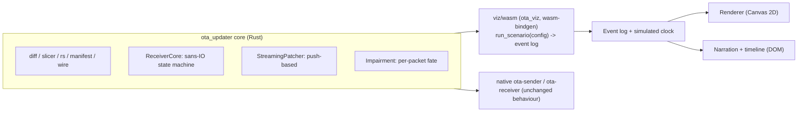

# OTA Explained — Visualization Design

An interactive, bilingual (EN / 中文) web explainer that shows how an OTA update travels from the
sender to many receivers: differencing, bit changes, compression, slicing, Reed-Solomon parity,
signing, broadcasting (packets flying, getting lost or corrupted), combining, streaming patching and
verified installation.

Every animation is driven by events produced by the **real `ota_updater` Rust engine compiled to
WebAssembly** — nothing is faked, so what users see is what the code does (raise the loss past what
the parity can repair and the update genuinely fails).

## 1. Decisions

| Topic | Decision |
|---|---|
| Audience | Mixed / non-specialist; technical depth available on demand |
| Format | Interactive web explainer, single self-contained HTML file (works offline and in the Review panel) |
| Data | Simulated in the browser by the real Rust core (WASM), deterministic seeds |
| Stack | Vite + TypeScript, Canvas 2D (particles, strips, grids) + DOM/SVG panels; `vite-plugin-singlefile`; WASM inlined as base64 and instantiated from bytes (no `fetch`) |
| Language | Bilingual EN / 中文 with a toggle; all copy lives in one i18n table |
| Milestones | **M1: broadcast sandbox** first, then the guided chapters |

## 2. Experience

### 2.1 Visual vocabulary (identical in every scene)

| Concept | Visual |
|---|---|
| Old / new image | Horizontal byte strips (blue = old, violet = new) |
| Diff "copy + adjust" region | Ribbon from the old range to the new range; diff bytes as a heat strip (grey = 0, bright = changed) |
| Extra (literal) bytes | Orange blocks in the new strip |
| Bits changing | Zoomed byte cell with 8 bits; flipped bits flash (`new ⊕ old`), next to `new − old` which bsdiff stores |
| Group / shard | Tile; hue = group; data = solid, parity = striped, implicit padding = ghost outline (shape, not only colour) |
| Packet in flight | Tile travelling on a curve from the antenna to each receiver |
| Lost / corrupted / duplicated / reordered | Falls and fades / red glitch then "CRC ✗" / splits in two / takes a detour and arrives late |
| RS combine | k tiles collapse into the group block; rebuilt (missing) tiles glow |
| Hash ✓ / ✗ | Badge on the group block; green tick or red cross |
| Signature | Seal on the manifest card; a forged one cracks |
| Streaming patch | The new image strip is written left → right by a write head while packets still arrive |
| A/B install | Slot B fills, verified, then becomes active |

### 2.2 M1 — Broadcast sandbox

- One sender (antenna) and 1–4 receivers, each with its own channel "weather": loss, mean burst
  length, corruption, duplication, reordering, seed, late join, base image, installed version.
- Sender settings: shard size, k, m, interleave, max rounds, packet rate.
- Presets: *Clean*, *Noisy Wi-Fi*, *Burst storm*, *Late joiner*, *Attacker* (forged shards + fake
  update signed with another key), *Rollback / wrong base*.
- Sender band: old/new strips with diff ribbons → patch bar → group tiles; the group being
  transmitted pulses.
- Receiver cards: group × shard grid filling up, FEC repairs, hash badges, streaming write strip,
  status (listening → manifest verified → receiving → verifying → installed / rejected / failed).
- Narration panel: context captions for what just happened (bilingual), legend, live counters.
- Transport: play / pause / step / speed (0.25×–16×) and a scrubbable timeline with markers
  (manifest, group complete, CRC failure, hash failure, installed, rejected).
- Scales: **Toy** (a few hundred bytes of readable text "firmware", uncompressed patch, tiny shards)
  and **Real** (1 MiB synthetic firmware, zstd patch).

### 2.3 Guided chapters (Story / Try it / Picture / Under the hood)

The page opens on **Learn step by step** (`#learn/N`); the sandbox is the second tab (`#sandbox`,
`#sandbox/<preset>`). Every chapter has a story paragraph (analogy), a "try it" hint, an interactive
figure computed by a real-engine lesson (`run_lesson`, §3.3) and a collapsible "under the hood"
section with the algorithm details and source files.

| # | Chapter | Interactive figure (lesson) |
|---|---|---|
| 1 | Big picture | Sender / air / device lanes; each stage links to its chapter, numbers from the real 1 MiB scenario |
| 2 | Diff | Editable old/new texts → real diff: byte provenance (same / adjusted / new), the edit script, the patch stream byte by byte, a bit inspector (old, new, XOR, stored `new − old`), and the suffix-array binary search step by step (`diff`, `suffix`) |
| 3 | Compress | Byte map of the real 1 MiB diff stream, share of zero bytes, size bars (raw / one frame / 16 KiB frames), byte histogram, hex window (`compress`) |
| 4 | Slice | Shard size / k / m → groups and shards with padding and implicit shards; hover shows shard bytes (`slice`) |
| 5 | Protect | Click shards to lose them → the real decoder's chosen rows, `[I; C]` matrix, inverse and rebuilt text, or "cannot rebuild"; one parity byte worked out as GF(2⁸) products and an XOR table (`rs`) |
| 6 | Sign | SHA-256 avalanche (flip one bit) and five manifest tamper attempts checked with `verify_strict` (`hash`, `sign`) |
| 7 | Broadcast | One round of the real schedule; move a loss burst and change interleaving → per-group survival (`interleave`) |
| 8 | Receive & combine | Flip a bit of a real shard packet → CRC32 mismatch; step through a real device (25 % loss, corruption) packet by packet with its events, grid and in-order release (`crc`, `run_scenario`) |
| 9 | Verify & install | A/B slots: corrupt one byte of slot B → hash mismatch, stay on A; links to the attacker / refusal presets (`install`) |

## 3. Architecture



### 3.1 Core changes (`ota_updater`)

1. **Feature gates**: `native` (default) = `socket2`, `getrandom`, C `zstd` and the CLIs. The WASM
   build uses `--no-default-features`; compression and decompression then use the pure-Rust `ruzstd`
   (same zstd frame format, so native and WASM patches interoperate). `ruzstd` only implements its
   *fastest* encoder level (≈ zstd 1), so WASM patches are larger than native level-19 ones.
2. **`StreamingPatcher`** — push-based `feed(bytes)` state machine (optionally reporting
   `PatchOp`s for the write head). The pull-based `patch::apply` is a thin loop over it. The old-image
   reader may differ between calls (its position is only trusted within one call).
3. **`PushDecompressor`** — push-based zstd decoding over concatenated frames. Within one frame
   `ruzstd` releases output only when the frame ends, so streaming requires the sender to compress
   the patch as independent frames: `SenderConfig::zstd_frame_size` (the simulation uses 16 KiB; the
   native CLI keeps a single frame because the C decoder streams within a frame).
4. **`ReceiverCore`** (`receiver/core.rs`) — the receiver state machine without I/O, threads or
   clocks: `handle(datagram) -> RxEvent*`. The native `receive()` wraps it (apply thread, timing).
5. **Observer hooks** — diff records (`diff_raw_traced`, kept in `Prepared::records`), RS decode
   plan (`decode_matrix`: selected rows and inverse), impairment per-packet fate (`process_tagged`).

### 3.2 Simulation and event log (`viz/wasm`)

`run_scenario(config_json) -> log_json` runs the whole seeded scenario at once:

1. Build the image pair (toy text or `imagegen`), diff, compress, slice, RS-encode, sign.
2. Carousel: packet `i` is sent at `t_i = i / rate` (+ round gaps); attacker packets are interleaved
   in the *Attacker* preset.
3. Per receiver: impairment fate per packet; deliveries arrive at `t + latency` (held-back packets
   arrive with the packet that releases them); `ReceiverCore` events; released groups are fed
   through push decompression into the `StreamingPatcher`; final SHA-256 check against the signed
   manifest.
4. Stop when every receiver is done (installed / rejected / failed) or after `max_rounds`.

Because the log is complete and deterministic, the renderer is a pure function of `(log, t)`;
scrubbing backwards simply replays the log from the start.

Log shape (abridged):

```text
summary   : sizes, ratio, groups, k, m, shard size, packets/round, interval, latency, manifest size
manifest  : session, fw version, SHA-256s, signature, public key, short group fingerprints
toy       : toy scale only → old/new text + per-byte class (same / changed / brand new)
heat      : per-bucket fraction of changed and brand-new bytes of the new image
records   : [new_off, old_off, diff_len, extra_len] per diff record
groups    : [{len, real}]
packets   : [{t, kind: 0 manifest | 1 shard | 2 attacker manifest | 3 attacker shard, g, i, r, src}]
receivers : [{spec, deliveries: [{p, t, f: ok|lost|corrupt|dup|late|off}], events: [{type, t, ...}], result}]
```

Receiver event types: `crc_bad`, `ignored`, `manifest_frag`, `manifest_bad_sig`, `manifest_ok`,
`rejected`, `buffered`, `stored`, `redundant`, `decoded {g, used, missing, ok}`, `released {g}`,
`write {new_off, len, kind: diff|extra}`, `verified {ok}`, `installed`, `failed {reason}`.
`eventDelivery[i]` is the index of the delivery whose processing produced event `i` (used by the
chapter 8 stepper; duplicates and released reordered packets share arrival times, so matching by
time would be ambiguous).

### 3.3 Chapter lessons (`run_lesson(name, args_json)`)

Small, synchronous calls into real engine code (`viz/wasm/src/lessons.rs`):

| Lesson | Engine code used |
|---|---|
| `diff` | `diff::diff_raw_traced`; the returned patch stream is parsed back into header / record / diff / extra segments |
| `suffix` | `suffix::suffix_array` + `diff::search_traced` (the diff's own search, reporting each step) |
| `compress` | `diff::diff_raw`, `diff::compress_zstd`, `diff::compress_zstd_framed` |
| `slice` | `slicer::Layout` |
| `rs` | `ReedSolomon::{encode, generator_row, decode_matrix, reconstruct}`, `gf256::mul` |
| `sign`, `hash` | `Manifest::{encode, sign}`, `manifest::verify_and_decode`, SHA-256 |
| `interleave` | `sender::prepare` + `Prepared::round_packets` (the real schedule) |
| `crc` | `wire::Packet::{encode, decode}` |
| `install` | the toy update's signed `new_sha256` vs SHA-256 of slot B |

Found while building chapter 2: bsdiff 4.3's search compares only `min(suffix len, query len)`
bytes, so a suffix that is a proper prefix of the query compares "equal" and the search goes left,
past longer matches ("anab" in "banana" → "a" instead of "ana"). Fixed in `diff::search_traced`
(regression test + a property test against brute force). Measured effect on the 1 MiB and 4 MiB
synthetic image pairs: none — the patches are byte-identical, since in the diff the query is the
whole rest of the new image, so only the last few suffixes of the old image can trigger it.

## 4. Phases

| Phase | Deliverable | Status |
|---|---|---|
| P0 | Feature-gate the core; build for `wasm32-unknown-unknown`; measure WASM size and diff speed; verify `ruzstd` streaming decode | done |
| P1 | `StreamingPatcher`, `PushDecompressor`, `ReceiverCore`, observer hooks; all native tests stay green | done |
| P2 | `viz/wasm` crate: `run_scenario`; native scenario tests | done |
| P3 (M1) | `viz/web` sandbox: layout, renderer, presets, timeline, EN/中文, single-file build → `viz/dist/ota-explained.html` | done |
| P4 | Guided chapters 1–9 with real-engine lessons, Learn / Sandbox routing | done |
| P5 | Polish: colour-blind-safe palette review, copy review (reduced motion and keyboard control exist) | next |
| Later | Live mode: `--events-jsonl` from the native CLIs bridged into the same viewer | |

## 5. Risks and fallbacks

- **zstd in WASM**: Apple clang has no wasm32 target, so the C library cannot be built → `ruzstd`.
  *Resolved*: push decoding works; streaming needs multi-frame patches (§3.1 item 3).
- **Diff speed in the browser**: *Measured* (Node 26 / V8, release WASM): a full *Real* scenario
  with a 1 MiB image runs in 140–260 ms, toy scenarios in 1–8 ms — no Web Worker needed; a
  "computing…" overlay covers the gap.
- **Few groups at production FEC parameters**: the sandbox uses visual-friendly parameters
  (toy: 16 B shards, k = 4, m = 2 → 6 groups; real: 512 B shards, k = 8, m = 4 → 20 groups).
- **Toy patches are not small**: at 288 bytes the patch header and record overhead outweigh the
  saving (326 B patch); the narration says so and points to the *Real* scale (79 KiB for 1 MiB).
- **ruzstd framing**: measured on the 1 MiB pair, ruzstd's 16 KiB-framed output (80,662 B) is
  smaller than its single frame (126,720 B); the cause was not investigated. Chapter 3 shows both.

## 6. Verification

- Native: existing tests stay green; push patcher ≡ pull patcher on random chunk boundaries and
  with a fresh reader per call; framed zstd streams (first output before ¼ of the input);
  `ReceiverCore` event sequences; all three builds (native, pure Rust, wasm32) pass clippy.
- Simulation: `cargo test -p ota_viz` checks installs, streaming, FEC repair, CRC rejection,
  attacker / rollback / wrong base / wrong key outcomes, determinism, the event → delivery mapping,
  and every lesson (diff segments tile the patch, longest-match search, RS recovers ≤ m losses only,
  every tampering fails the signature, interleaving saves a burst, every bit flip fails the CRC).
- WASM: `node viz/web/scripts/smoke.mjs` runs every preset at both scales through the real module.
- Web: `viz/web/scripts/browser-smoke.mjs` loads the built page in headless Chromium, plays every
  preset at both scales to the end, renders all nine chapters (EN and 中文), exercises the key
  interactions (lose shards, tamper, flip a CRC bit, step a device to "installed", corrupt slot B),
  checks console errors and saves screenshots.

## 7. Build and run

```
./viz/build-wasm.sh                      # cargo → wasm32, wasm-bindgen (+ wasm-opt) → viz/web/src/pkg
cd viz/web && npm install                # vite, vite-plugin-singlefile, typescript
npm run typecheck && npm run build       # → viz/dist/ota-explained.html (single file, ≈ 975 KB)
npm run smoke                            # WASM presets under Node
PLAYWRIGHT_CORE=/path/to/playwright-core node scripts/browser-smoke.mjs   # optional browser check
npm run dev                              # live development server
```

Open `viz/dist/ota-explained.html` directly in a browser (no server needed). It opens on chapter 1;
`#sandbox` (or `#sandbox/attacker`, …) opens the sandbox. Sandbox keyboard: space = play/pause,
←/→ = previous/next moment, Home = restart.

Measured: WASM module 626 KiB with the lessons (wasm-opt -O3); built page ≈ 975 KB.
